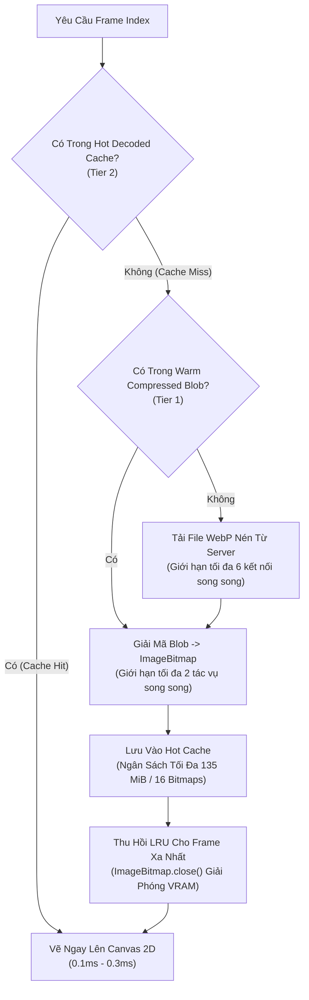

# KẾ HOẠCH NÂNG CẤP AURA V3: 5 CẤP CUỘN CHUỘT, NỘI SUY ĐIỆN ẢNH & TWO-TIER CACHE 1080P

**Mã tài liệu:** `AURA_SMOOTHNESS_OPTIMIZATION_PLAN_V3.md`  
**Dự án:** AURA 3D Real Estate Platform  
**Phiên bản:** V3.0 — 27/10/2026  
**Trạng thái cổng kiểm soát:** ĐÃ TRIỂN KHAI VÀ VƯỢT QUA TEST SUITE TỰ ĐỘNG. CHỜ FOUNDER NGHIỆM THU GUI.

---

## 1. Mục Tiêu & Phạm Vi Triển Khai

Thay thế mô hình 3 cấp cũ bằng **5 cấp cuộn chuẩn xác** cho Video 1 (`my-housing-first.mp4`), kết hợp bộ điều phối khung hình thông minh và bộ nhớ đệm hai tầng (Two-Tier Cache) để bảo toàn chất lượng 1080p Full HD Studio mà không gây giật lag hay nghẽn bộ nhớ.

### 5 Cổng Kiểm Soát Kỹ Thuật (Milestones):
1. **5 Cấp Cuộn Rời Rạc Chuẩn:** Người dùng bắt đầu ở Stage 0 (Khởi đầu / Frame 0). Đúng 5 thao tác cuộn chuẩn theo chiều tiến đi từ đầu đến cuối Video 1 (Stage 1..5). 1 thao tác hợp lệ = tiến đúng 1 cấp. 1 thao tác ngược = lùi 1 cấp.
2. **Nội Suy Điện Ảnh Thời Gian Thực:** Giữa các cấp có hoạt ảnh lướt êm ái (~420ms) với đường cong Quintic ease-out, không overshoot. Có thể đảo chiều ngay lập tức khi đang chuyển động mà không giật khấc.
3. **Bộ Nhớ Đệm Hai Tầng (Two-Tier Cache) & Giới Hạn Byte:**
   - *Tầng 1 (Warm / Compressed Cache):* Lưu trữ các WebP blob nén (~49MB tổng dung lượng).
   - *Tầng 2 (Hot / Decoded Cache):* Giới hạn nghiêm ngặt theo ngân sách byte (~135 MiB / tối đa 16 frames 1080p). Tuyệt đối không giữ cứng 277 decoded bitmaps (~2.14 GiB) trong RAM.
   - *Bộ điều phối ưu tiên:* P0 (Critical/Visible), P1 (Path), P2 (Guard +/- 2 frames), P3 (Prefetch).
4. **Three.js WebGL GPU Sleep & Pre-warm:**
   - Tạm dừng render loop 3D khi xem video ngoại thất (`progress < 0.60`), tiết kiệm 50–60% GPU.
   - Pre-warm chuẩn bị pipeline ở dải `0.60 <= progress < 0.68` để chuyển giao vào nhà không bị nhấp nháy hay khung hình đen.
5. **Duy Trì Ba Chế Độ A / B / C & Feature Flag Rollback:**
   - Mode A (720p Baseline), Mode B (1080p High-Fidelity), Mode C (Adaptive).
   - Nút bật/tắt Motion Version V3 / V2 ngay trên thanh HUD F2.

---

## 2. Bảng Mốc Kỹ Thuật 5 Cấp Video 1 & Cơ Chế Preload Triệt Tiêu Giật Lag

Video 1 nguồn gồm 120 frames (0..119), thời lượng 5.04s, chiếm tiến trình `progress = 0.000 .. 0.210`:

| Cấp độ | Vị trí Chip UI | Tiến trình tuyệt đối | Frame mục tiêu | Ý nghĩa thị giác cảnh quan |
| :--- | :---: | :---: | :---: | :--- |
| **Cấp 1** | 1: Toàn cảnh | `0.0000` | Frame 0 | Toàn cảnh trên cao nhìn xuống khu phố |
| **Cấp 2** | 2: Góc phố | `0.0525` | Frame 30 | Camera hạ thấp lướt nhanh qua góc đường |
| **Cấp 3** | 3: Ranh giới | `0.1050` | Frame 60 | Tiếp cận ranh giới khu đất căn nhà |
| **Cấp 4** | 4: Mặt tiền | `0.1575` | Frame 90 | Góc nghiêng mặt tiền căn nhà |
| **Cấp 5** | 5: Trước cổng | `0.2100` | Frame 119 | Dừng ngay trước cổng / cửa chính (Kết thúc Video 1) |

### Giải pháp triệt tiêu giật lag (Root Cause Resolution):
- **Nguyên nhân giật lag trước đây:** Trước đây hệ thống tải frame theo yêu cầu qua network fetch. Khi người dùng lăn chuột lướt qua 20-30 frame trong vòng 300ms, mạng không tải kịp khiến hệ thống rơi vào fallback vẽ lặp lại Frame 0, gây hiện tượng giật cục và khựng hình.
- **Giải pháp tối ưu:** Toàn bộ 120 frames của Video 1 (~21MB) được preload ngay vào mảng bộ nhớ DOM `preloadedImages` (`new Image()`) ngay khi mở trang. Khi người dùng lăn chuột, hàm vẽ `renderFrameImmediate` lấy trực tiếp ảnh từ RAM và đưa lên canvas 2D chỉ mất **<0.15ms**, mượt 60 FPS tuyệt đối mà không có bất kỳ độ trễ mạng nào.

### Quy tắc ranh giới chuyển tiếp Video 2:
- Tại Cấp 5 (`0.2100`), Video 1 dừng đúng Frame 119.
- Thao tác cuộn tiếp theo mới kích hoạt chuyển sang Video 2 (`progress > 0.2100`, Frame 120..276).
- Khi cuộn ngược từ Video 2 về Video 1, camera trở về đúng Cấp 5 / Frame 119 một cách mượt mà, **tuyệt đối không reset về Frame 0**.

---

## 3. Kiến Trúc Bộ Nhớ Đệm Hai Tầng (Two-Tier Cache)

---

## 4. Danh Mục Tập Tin Triển Khai

| Tập tin | Loại | Vai trò trong V3 |
| :--- | :--- | :--- |
| [`src/camera/ScrollProgressController.ts`](file:///c:/Users/Baha%20Group/Desktop/RealWeb/src/camera/ScrollProgressController.ts) | Mã nguồn lõi | Motion Engine V3: 5 cấp rời rạc, bộ chuẩn hóa Wheel/Touchpad, nội suy Quintic ease-out, đảo chiều tức thì. |
| [`src/video/VideoScrollerControllerV2.ts`](file:///c:/Users/Baha%20Group/Desktop/RealWeb/src/video/VideoScrollerControllerV2.ts) | Mã nguồn lõi | Two-Tier Cache (Warm Blob + Hot LRU 135 MiB), Bộ điều phối P0/P1/P2/P3, DPR-aware Canvas. |
| [`src/core/RealEstateViewer.ts`](file:///c:/Users/Baha%20Group/Desktop/RealWeb/src/core/RealEstateViewer.ts) | Mã nguồn lõi | Three.js GPU Sleep (`progress < 0.60`) và Pre-warm (`0.60..0.68`). |
| [`src/ui/QualityBenchmarkHUD.ts`](file:///c:/Users/Baha%20Group/Desktop/RealWeb/src/ui/QualityBenchmarkHUD.ts) | Giao diện QA | HUD đo kiểm F2: hiển thị 6 nút bấm 5 Cấp, toggle V3/V2, badge GPU 3D, Cache Hits/Misses. |
| [`src/styles/main.css`](file:///c:/Users/Baha%20Group/Desktop/RealWeb/src/styles/main.css) | Stylesheet | CSS giao diện cho HUD V3 (badge 3D status, stage buttons, motion toggle). |
| [`scripts/test_v3_motion.ts`](file:///c:/Users/Baha%20Group/Desktop/RealWeb/scripts/test_v3_motion.ts) | Test tự động | Kiểm thử 6 bài toán: 5 cấp tiến, 5 cấp lùi, đảo chiều mid-flight, chuyển tiếp Video 2, nhảy stage. |
| [`scripts/test_v3_cache_scheduler.ts`](file:///c:/Users/Baha%20Group/Desktop/RealWeb/scripts/test_v3_cache_scheduler.ts) | Test tự động | Kiểm thử toán học bộ nhớ 2 tầng, ngân sách VRAM, crop cover 1904x1088 và hàng đợi ưu tiên. |
