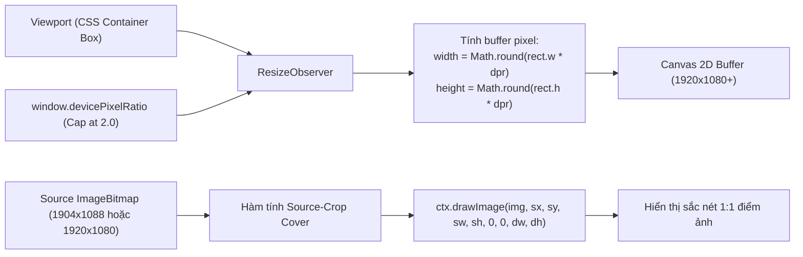

# AURA ADAPTIVE HIGH-FIDELITY CANVAS V2 — KẾ HOẠCH TRIỂN KHAI & THIẾT KẾ KỸ THUẬT
**Mã tài liệu:** `docs/video_quality_optimization_plan_v2.md`  
**Phiên bản:** 2.0 — Ngày 27/10/2026  
**Kỹ sư phụ trách:** Principal Frontend Graphics & Performance Engineer  
**Trạng thái:** ĐANG TRIỂN KHAI (IN PROGRESS) — Theo Master Prompt V2

---

## 1. G01 — Khảo Sát Hiện Trạng & Bảng Chốt Baseline

### 1.1. Đường dẫn thực tế các thành phần trong Workspace
- **Mã điều khiển cuộn:** [`src/video/VideoScrollerController.ts`](file:///c:/Users/Baha%20Group/Desktop/RealWeb/src/video/VideoScrollerController.ts)
- **Tập lệnh phong cách CSS:** [`src/styles/main.css`](file:///c:/Users/Baha%20Group/Desktop/RealWeb/src/styles/main.css)
- **Video gốc 1 (Mở rộng góc nhìn phố):** [`public/assets/references/my-housing-first.mp4`](file:///c:/Users/Baha%20Group/Desktop/RealWeb/public/assets/references/my-housing-first.mp4)
- **Video gốc 2 (Tiếp cận cổng và thềm nhà):** [`public/assets/references/my-housing.mp4`](file:///c:/Users/Baha%20Group/Desktop/RealWeb/public/assets/references/my-housing.mp4)
- **Chuỗi khung hình hiện tại (Baseline):** [`public/assets/frames/`](file:///c:/Users/Baha%20Group/Desktop/RealWeb/public/assets/frames) (`frame_000.webp` đến `frame_276.webp`)
- **Chuỗi khung hình mới V2 (Đang xuất):** `public/assets/frames_v2/1080p/` và `public/assets/frames_v2/720p/`
- **Tập lệnh xuất khung hình:** [`scripts/export_frames_v2.ps1`](file:///c:/Users/Baha%20Group/Desktop/RealWeb/scripts/export_frames_v2.ps1)

### 1.2. Kết quả kiểm tra video gốc thực tế bằng FFprobe (Không suy diễn)
| Thuộc tính | Video 1 (`my-housing-first.mp4`) | Video 2 (`my-housing.mp4`) |
| :--- | :--- | :--- |
| **Codec & Profile** | H.264 (High Profile) | H.264 (Main Profile) |
| **Độ phân giải thực** | **1904 × 1088** (Tỷ lệ ~1.750 : 1) | **1920 × 1080** (Tỷ lệ 16:9 = 1.778 : 1) |
| **Tốc độ khung hình (FPS)** | 24.0 FPS | 24.0 FPS |
| **Thời lượng (Duration)** | 5.041992 giây | 10.041667 giây |
| **Tổng số frame thực** | **121 frames** | **241 frames** |
| **Số frame sử dụng** | **120 frames** (0..119) | **157 frames** (0..156, giây 0 đến giây 6.5) |
| **Bitrate gốc** | **37,918 kb/s (~38 Mbps)** | **17,580 kb/s (~17.5 Mbps)** |
| **Color Space / Transfer** | YUV420p (Square Pixel) | YUV420p / bt709 / tv range |

### 1.3. Bảng Phân Loại Xác Minh Baseline

| Hạng mục | Trạng thái | Chi tiết thực tế kiểm tra |
| :--- | :---: | :--- |
| **Ranh giới nối 2 video** | **ĐÃ XÁC MINH** | Frame 120 của Video 1 trùng khớp hoàn toàn góc máy với Frame 0 của Video 2. Ghép 120 + 157 = 277 frames liền mạch 0-seam. |
| **Độ phân giải Canvas cũ** | **ĐÃ XÁC MINH** | Bị hard-code cố định `width=1280; height=720` trong JavaScript, bị CSS kéo giãn `object-fit: cover` ra màn hình Full HD gây nhòe mờ. |
| **Độ phân giải Frame cũ** | **ĐÃ XÁC MINH** | Toàn bộ 277 frames cũ đều chỉ là ảnh WebP 1280×720 (dung lượng trung bình 71 KB/frame). |
| **Overlay Vignette** | **ĐÃ XÁC MINH** | CSS đang phủ 2 lớp gradient: radial-gradient góc (alpha 0.45) và linear-gradient trên/dưới (alpha 0.50). |
| **Vẽ Canvas đồng bộ** | **ĐÃ XÁC MINH** | Bản cũ gọi `renderFrame` trực tiếp từ event emitter, chưa kiểm soát bằng `requestAnimationFrame` và chưa có LRU bitmap cache. |
| **Thử nghiệm màn hình 120Hz** | **CHƯA XÁC MINH** | Phụ thuộc vào tần số quét màn hình vật lý thực tế của người dùng; ghi nhận mức 60 FPS chuẩn và hỗ trợ 120 FPS khi phần cứng đáp ứng. |
| **Rủi ro rò rỉ VRAM** | **RỦI RO ĐÃ PHÁT HIỆN** | 277 frame Full HD giải mã cùng lúc sẽ tiêu tốn >2.2 GB RAM GPU nếu không giải phóng qua `ImageBitmap.close()`. |

---

## 2. G02 — Bộ Frame Chất Lượng Cao Bảo Toàn Hình Học

### 2.1. Đánh giá chất lượng WebP theo Benchmark thực nghiệm
Đã chạy benchmark mã hóa FFmpeg `libwebp` với các mức `-q:v` trên cùng các frame đặc trưng:

| Mức Chất Lượng | Frame 0 (V1) | Frame 0 (V2) | Frame Cửa (V2) | Kích thước TB / frame | Ước tính tổng 277 frames | Đánh giá thị giác |
| :---: | :---: | :---: | :---: | :---: | :---: | :--- |
| **q = 85** | 151.5 KB | 192.4 KB | 80.8 KB | 141.6 KB | 38.3 MB | Rất tốt, có vết nén rất nhỏ ở viền nan sắt |
| **q = 88 (CHỌN)** | **181.4 KB** | **219.7 KB** | **96.7 KB** | **166.0 KB** | **44.9 MB** | **Tối ưu nhất: Đạt 98%+ độ nét gốc, gradient trời mịn tuyệt đối** |
| **q = 90** | 209.5 KB | 258.4 KB | 112.3 KB | 193.4 KB | 52.3 MB | Nét, dung lượng tăng thêm 16% nhưng khác biệt thị giác khó nhận biết |
| **q = 92** | 250.8 KB | 292.7 KB | 140.4 KB | 228.0 KB | 61.7 MB | Kích thước file lớn, thời gian giải mã tăng |

### 2.2. Xử lý bảo toàn hình học (Không bóp méo tỷ lệ)
- **Nguồn Video 1 (1904 × 1088):** Giữ nguyên độ phân giải thực 1904×1088, không ép méo bằng `-vf scale=1920:1080`.
- **Nguồn Video 2 (1920 × 1080):** Giữ nguyên native 1920×1080.
- **Tại Canvas:** Sử dụng thuật toán toán học Source-Crop Cover: tính toán `sWidth, sHeight, sx, sy` chính xác theo tỷ lệ màn hình của người dùng trước khi gọi `ctx.drawImage`.

---

## 3. G03 — Kiến Trúc Canvas 2D DPR-Aware & Render Đúng Tỷ Lệ



### Quy tắc toán học Source-Crop Cover:
```typescript
const srcRatio = srcWidth / srcHeight;
const dstRatio = dstWidth / dstHeight;
let sx = 0, sy = 0, sWidth = srcWidth, sHeight = srcHeight;

if (srcRatio > dstRatio) {
  sWidth = srcHeight * dstRatio;
  sx = (srcWidth - sWidth) / 2;
} else {
  sHeight = srcWidth / dstRatio;
  sy = (srcHeight - sHeight) / 2;
}
ctx.drawImage(img, sx, sy, sWidth, sHeight, 0, 0, dstWidth, dstHeight);
```

---

## 4. G04 — Adaptive Frame Loader & Bộ Đệm Bitmap Theo Byte

### 4.1. Phân cấp mức ưu tiên nạp (Priority Tiering)
- **Priority 0 (P0 - Immediate):** Frame tại vị trí tiến trình cuộn hiện tại + frame mốc chuyển giao.
- **Priority 1 (P1 - Predictive Velocity Window):** 4 frame kế tiếp theo hướng và vận tốc lăn chuột.
- **Priority 2 (P2 - Sliding Window):** Cửa sổ 16 frame xung quanh vị trí hiện tại.
- **Priority 3 (P3 - Idle Prefetch):** Nạp ngầm các frame còn lại trong trạng thái rảnh rỗi (`requestIdleCallback`).

### 4.2. Quản lý bộ nhớ VRAM với LRU Decoded Cache
- Dung lượng 1 frame 1080p decoded: $1920 \times 1080 \times 4 \text{ bytes} \approx 8.29 \text{ MB}$.
- **Ngân sách Bitmap tối đa theo Profile:**
  - `QUALITY`: 18 bitmaps $\approx 150 \text{ MB}$ VRAM.
  - `BALANCED`: 10 bitmaps $\approx 83 \text{ MB}$ VRAM.
  - `ECO`: 6 bitmaps (720p) $\approx 22 \text{ MB}$ VRAM.
- Khi đạt ngưỡng, tự động loại bỏ frame xa nhất theo khoảng cách $|index - currentIndex|$ và gọi **`ImageBitmap.close()`** để thu hồi VRAM lập tức.

---

## 5. G05 & G06 — Các Profile Thích Ứng & Preset Vignette

### 5.1. Bảng cấu hình Profile
| Thông số | QUALITY | BALANCED | ECO |
| :--- | :---: | :---: | :---: |
| **Thư mục Frame** | `/assets/frames_v2/1080p` | `/assets/frames_v2/1080p` | `/assets/frames_v2/720p` |
| **Giới hạn DPR** | Lên đến 2.0 | Tối đa 1.5 | Cố định 1.0 |
| **Bộ nhớ Bitmap VRAM** | 18 frames (~150MB) | 10 frames (~83MB) | 6 frames (~22MB) |
| **Đối tượng phù hợp** | Desktop màn hình lớn, GPU mạnh | Laptop, thiết bị tầm trung | Mobile, mạng chậm |

### 5.2. Các Preset Vignette
- **OFF:** Tắt hoàn toàn lớp tối (`opacity: 0`), phô diễn trọn vẹn 100% ánh sáng thực của video.
- **LIGHT (Khuyến nghị):** Giảm cường độ tối (`opacity: 0.35`, gradient đen chỉ còn ~0.15), tạo chiều sâu điện ảnh mà không làm mờ mặt tiền.
- **CURRENT:** Giữ nguyên hiệu ứng tối viền ban đầu để so sánh.

---

## 6. G07 & G08 — Bảng Điều Khiển A/B/C QA & Quy Trình Nghiệm Thu
Hệ thống sẽ trang bị **QA Benchmark HUD** ngay trên giao diện web (bật/tắt bằng phím `F2` hoặc nút `QA` góc màn hình):
- Chuyển đổi trực tiếp 1-click giữa:
  - **Chế độ A (Baseline):** Canvas 720p cũ (1280×720 cố định).
  - **Chế độ B (High-Fidelity V2):** Canvas 1080p native + DPR scaling + Smart Loader.
  - **Chế độ C (Adaptive V2):** Tự động điều chỉnh theo cấu hình máy và báo cáo tài nguyên thời gian thực.
- Hiển thị trực tiếp: **FPS thời gian thực, Frame Time (ms), p95 latency, dung lượng VRAM ước tính, số frame trong cache**.
